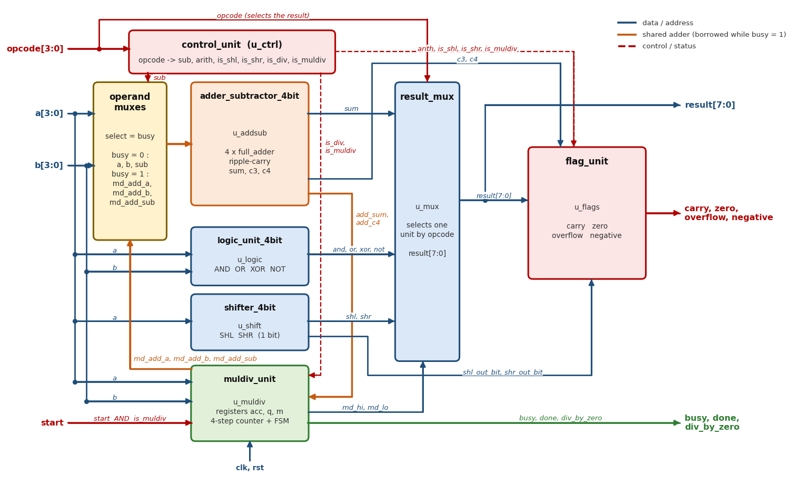
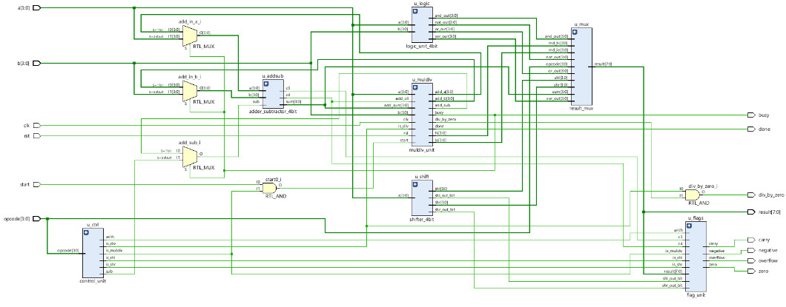
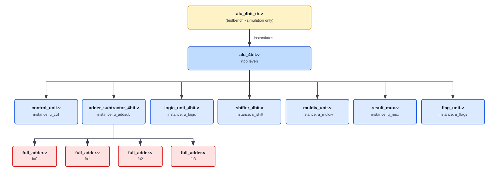
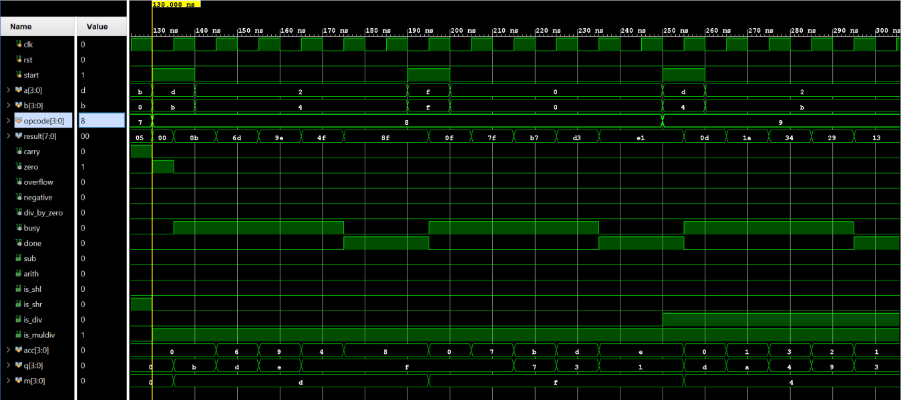
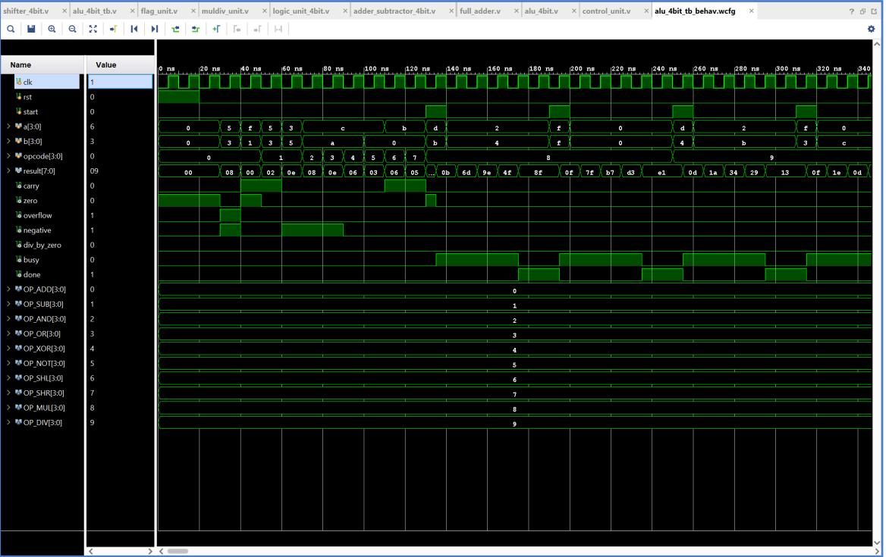

# 4-bit ALU with Sequential Multiply and Divide (Verilog HDL)


RTL design and verification of a **4-bit Arithmetic Logic Unit** written in Verilog HDL. Besides the usual eight single-cycle operations (`ADD`, `SUB`, `AND`, `OR`, `XOR`, `NOT`, `SHL`, `SHR`), it performs **multiplication and division** by shifting and **re-using the ALU's own adder/subtractor**, instead of building a separate multiplier or divider array. The design produces an 8-bit result and five status flags, is verified exhaustively (all 4,096 opcode/operand combinations), and was implemented in Vivado for a Xilinx Artix-7 FPGA.



---

## Table of Contents

1. [Overview](#1-overview)
2. [Key Features](#2-key-features)
3. [Architecture](#3-architecture)
4. [Interface and Opcode Map](#4-interface-and-opcode-map)
5. [Operation Details](#5-operation-details)
6. [Module Descriptions](#6-module-descriptions)
7. [Repository Structure](#7-repository-structure)
8. [Getting Started](#8-getting-started)
9. [Verification](#9-verification)
10. [Results](#10-results)
11. [Limitations and Future Work](#11-limitations-and-future-work)
12. [Tools and Environment](#12-tools-and-environment)
13. [License](#13-license)

---

## 1. Overview

The ALU is the part of a processor that carries out every arithmetic and logic calculation an instruction asks for. This project goes beyond the usual combinational ALU in three ways:

- **Ten operations** in modular Verilog, with one sub-module per function.
- **Multiply and divide without a multiplier array.** `MUL` uses shift-and-add and `DIV` uses restoring shift-and-subtract, both reusing the ALU's own 4-bit adder/subtractor over several clock cycles. This keeps the circuit small, at the cost of 5 clock cycles per operation instead of 1.
- **Complete status reporting:** carry, zero, overflow, negative and divide-by-zero flags, plus `busy` / `done` handshake signals for the multi-cycle operations.

A detailed design report (module-by-module truth tables, waveforms and the full Vivado flow) is available in [`doc/ALU_4bit_Report.pdf`](doc/ALU_4bit_Report.pdf).

**Quick start** (requires [Icarus Verilog](https://steveicarus.github.io/iverilog/)):

```bash
iverilog -g2005 -o alu_tb.vvp rtl/*.v testbench/alu_4bit_tb.v
vvp alu_tb.vvp          # last line: "PASS: all 4096 input combinations verified, 0 errors"
```

## 2. Key Features

| Feature | Description |
|---|---|
| Operands | `a`, `b`: 4 bits each |
| Result | 8 bits (wide enough to hold a full 4 x 4 product) |
| Operations | `ADD`, `SUB`, `AND`, `OR`, `XOR`, `NOT`, `SHL`, `SHR` (1 clock cycle) and `MUL`, `DIV` (5 clock cycles) |
| Status flags | `carry`, `zero`, `overflow`, `negative`, `div_by_zero` |
| Handshake | `start` (input, one-clock pulse) and `busy`, `done` (outputs), used only by `MUL` / `DIV` |
| Hardware sharing | One adder/subtractor serves `ADD`, `SUB`, `MUL` and `DIV` |
| Adder style | Ripple-carry, built from four gate-level `full_adder` instances |
| Reset | Asynchronous, active high |
| Modularity | 9 Verilog files, one module per function |
| Verification | Self-checking testbench: all 16 opcodes x 256 operand pairs = 4,096 cases, plus protocol scenarios (30,563 comparisons, 0 errors) |
| FPGA cost | 62 LUTs and 18 flip-flops on Artix-7 (see [Results](#10-results)) |

## 3. Architecture

### 3.1 Block Diagram

`alu_4bit` instantiates seven sub-modules. The adder/subtractor, the logic unit, the shifter and the multiply/divide unit all work on the same operands in parallel, and `result_mux` selects the single output that the opcode asks for. `control_unit` decodes the opcode once into six one-bit control signals.


The Vivado elaborated schematic of the same design:



### 3.2 Module Hierarchy



`alu_4bit.v` is the top level: it instantiates every other module and contains no computation of its own beyond the three operand multiplexers that implement adder sharing. Every module is instantiated exactly once, except `full_adder`, which is instantiated four times inside `adder_subtractor_4bit` to form the ripple-carry chain. The testbench `alu_4bit_tb.v` is simulation-only and is never synthesized.

### 3.3 How the Adder Is Shared

A fully combinational multiplier or divider needs on the order of n² gates. Doing one step per clock with a single n-bit adder grows only linearly with n. Because `MUL` needs an adder and `DIV` needs a subtractor, and the ALU already contains exactly that circuit, `muldiv_unit` has **no adder of its own**:

- When `busy = 0`, three 2-to-1 multiplexers in `alu_4bit` pass `a`, `b` and `sub` to the adder, which then serves `ADD` and `SUB`.
- When `busy = 1`, the multiplexers pass `md_add_a`, `md_add_b` and `md_add_sub` from `muldiv_unit` instead, and the adder's `sum` and `c4` outputs are read back by `muldiv_unit`.

This is the orange loop in the block diagram above.

### 3.4 Theory in Brief

**Carry versus overflow.** Four bits hold 16 patterns: read as unsigned they are 0 to 15, read as two's complement they are -8 to +7. The same adder gives the correct bit pattern for both; only the meaning of the flags differs. Subtraction is addition of the complement: `a - b = a + ~b + 1`, so each bit of `b` passes through an XOR gate controlled by `sub`, and `sub` is also the carry-in. `carry` (the fifth bit, `c4`) says whether the *unsigned* result exceeded 15 (for `SUB`, `carry = 1` means *no borrow*). `overflow` says whether the *signed* result left the range -8 to +7: for `a + b` when both operands have the same sign and the result has the other sign, for `a - b` when the operands have different signs and the result's sign differs from that of `a`. In hardware both cases are detected as `c3 XOR c4` (the carry into the sign bit differing from the carry out of it).

**Multiply as shift-and-add.** Using registers `acc`, `q` (multiplier) and `m` (multiplicand), on each of four steps: if `q[0] = 1`, add `m` into `acc`; then shift `{carry, acc, q}` one place right. After four steps the 8-bit product is `{acc, q}`.

**Divide as restoring shift-and-subtract.** On each of four steps, shift `{acc, q}` one place left and try `acc - m`. If it fits (no borrow), keep the difference and set the new quotient bit to 1; otherwise keep (restore) the shifted value and set the bit to 0. After four steps the quotient is in `q` and the remainder in `acc`. Dividing by zero always "fits", so the unit naturally produces quotient `1111` and remainder equal to the dividend, and also raises `div_by_zero`.

In the RTL the decision is `fits = r_top OR (no borrow)`, where `r_top` is the bit shifted out of the top of `acc`. For a 4-bit dividend `r_top` is **always 0**: before step *k* only *k - 1* bits of the dividend have entered `acc`, so `acc` is at most 7 before every step (checked by simulation over all 256 operand pairs: `r_top` never became 1 and the largest `acc` was 7). The term is a safeguard that would only matter for a dividend wider than the accumulator; for this ALU, `fits` simply means "the subtraction produced no borrow".

## 4. Interface and Opcode Map

### 4.1 Ports of `alu_4bit`

| Port | Direction | Width | Description |
|---|---|---|---|
| `clk` | input | 1 | Clock (used only by `MUL` / `DIV`) |
| `rst` | input | 1 | Asynchronous reset, active high |
| `start` | input | 1 | One-clock pulse that begins `MUL` / `DIV` |
| `a`, `b` | input | 4 each | Operands |
| `opcode` | input | 4 | Operation select |
| `result` | output | 8 | Final answer |
| `carry`, `zero`, `overflow`, `negative` | output | 1 each | Status flags |
| `div_by_zero` | output | 1 | Set when the last `DIV` had `b = 0` (only visible while `opcode = DIV`) |
| `busy` | output | 1 | `1` while a `MUL` / `DIV` is running |
| `done` | output | 1 | `1` when a `MUL` / `DIV` result is ready; held until the next `start` |

For single-cycle opcodes the result and flags are valid immediately (combinational), with no dependency on the clock.

### 4.2 Opcode Map

| Opcode | Operation | `result[7:0]` | Clock cycles |
|---|---|---|---|
| `0000` | `ADD` | `{0000, a + b}` | 1 |
| `0001` | `SUB` | `{0000, a - b}` | 1 |
| `0010` | `AND` | `{0000, a & b}` | 1 |
| `0011` | `OR` | `{0000, a \| b}` | 1 |
| `0100` | `XOR` | `{0000, a ^ b}` | 1 |
| `0101` | `NOT` | `{0000, ~a}` (operand `b` unused) | 1 |
| `0110` | `SHL` | `{0000, a << 1}` (operand `b` unused) | 1 |
| `0111` | `SHR` | `{0000, a >> 1}` (operand `b` unused) | 1 |
| `1000` | `MUL` | `a x b` (full 8-bit product) | 5 |
| `1001` | `DIV` | `{remainder, quotient}` of `a / b` | 5 |
| `1010` to `1111` | unused | `00000000` | 1 |

`MUL` and `DIV` treat `a` and `b` as **unsigned** numbers (0 to 15). Value ranges of `result`:

| Operation | `result[7:0]` range | Notes |
|---|---|---|
| `ADD`, `SUB`, logic, shifts | `result[3:0]` = 0 to 15, `result[7:4]` = 0 | flags as in Section 5.2 |
| `MUL` | 0 to 225 (`15 x 15`) | `carry` = `overflow` = `negative` = 0; `zero` = 1 only when `a = 0` or `b = 0` |
| `DIV`, `b != 0` | quotient 0 to 15, remainder 0 to 14 (remainder < `b`) | `zero` = 1 only when `a = 0` |
| `DIV`, `b = 0` | quotient 15 (`1111`), remainder = `a` | `div_by_zero` = 1 |
| unused opcodes | 0 | `zero` = 1; `carry`, `overflow`, `negative` = 0 |

## 5. Operation Details

### 5.1 Single-Cycle Operations: Examples

The rows below are printed by Part 1 of the testbench (`ADD`, `SUB` and the logic/shift operations are unsigned 4-bit values; the flags follow the rules in Section 5.2).

| Operation | `a` | `b` | `result` | `C` | `Z` | `V` | `N` | Note |
|---|---|---|---|---|---|---|---|---|
| `ADD` | 5 | 3 | `00001000` (8) | 0 | 0 | 1 | 1 | 5 + 3 = 8 exceeds the signed maximum of 7 |
| `ADD` | 15 | 1 | `00000000` (0) | 1 | 1 | 0 | 0 | unsigned wrap-around: carry out |
| `SUB` | 5 | 3 | `00000010` (2) | 1 | 0 | 0 | 0 | `C = 1`: no borrow |
| `SUB` | 3 | 5 | `00001110` (14) | 0 | 0 | 0 | 1 | `C = 0`: borrow; as signed this is -2 |
| `AND` | 12 | 10 | `00001000` (8) | 0 | 0 | 0 | 1 | `1100 & 1010` |
| `OR` | 12 | 10 | `00001110` (14) | 0 | 0 | 0 | 1 | `1100 \| 1010` |
| `XOR` | 12 | 10 | `00000110` (6) | 0 | 0 | 0 | 0 | `1100 ^ 1010` |
| `NOT` | 12 | - | `00000011` (3) | 0 | 0 | 0 | 0 | `~1100` |
| `SHL` | 11 | - | `00000110` (6) | 1 | 0 | 0 | 0 | `1011 << 1`, bit shifted out = 1 |
| `SHR` | 11 | - | `00000101` (5) | 1 | 0 | 0 | 0 | `1011 >> 1`, bit shifted out = 1 |

### 5.2 Flag Rules

| Operation | `carry` | `overflow` | `zero` | `negative` |
|---|---|---|---|---|
| `ADD` | carry out of bit 3 (`c4`): unsigned sum > 15 | `c3 XOR c4`: signed result outside -8..7 | `1` when the whole 8-bit result is 0 | `result[3]` |
| `SUB` | `c4`: `1` means **no borrow** (`a >= b`) | `c3 XOR c4` | same | `result[3]` |
| `AND`, `OR`, `XOR`, `NOT` | 0 | 0 | same | `result[3]` |
| `SHL` | `a[3]` (bit shifted out) | 0 | same | `result[3]` |
| `SHR` | `a[0]` (bit shifted out) | 0 | same | `result[3]` |
| `MUL`, `DIV` | 0 | 0 | same | 0 (results are unsigned) |
| unused opcodes | 0 | 0 | 1 (result is 0) | 0 |

### 5.3 Multiply and Divide: Step by Step

Both operations take **5 clock cycles from `start` to `done`**: 1 load cycle plus 4 step cycles. The tables below were obtained by simulating this RTL and reading the internal registers after each rising clock edge.

In the `DIV` tables, *partial* is the shifted accumulator `{acc[2:0], q[3]}` that the divisor `m` is compared with (the value after bringing down the next dividend bit); the divisor *fits* when `partial >= m`, i.e. when `partial - m` produces no borrow.

**`MUL` 13 x 11 = 143** (`acc` = upper half of the product, `q` = multiplier then lower half, `m` = multiplicand)

| Clock | Action | `acc` | `q` | `m` | `result` | `busy` | `done` |
|---|---|---|---|---|---|---|---|
| Load | `acc = 0`, `q = b = 1011`, `m = a = 1101` | `0000` | `1011` | `1101` | `0x0B` | 1 | 0 |
| Step 1 | `q[0] = 1`: `0000 + 1101`, shift right | `0110` | `1101` | `1101` | `0x6D` | 1 | 0 |
| Step 2 | `q[0] = 1`: `0110 + 1101`, shift right | `1001` | `1110` | `1101` | `0x9E` | 1 | 0 |
| Step 3 | `q[0] = 0`: no add, shift right | `0100` | `1111` | `1101` | `0x4F` | 1 | 0 |
| Step 4 | `q[0] = 1`: `0100 + 1101`, shift right | `1000` | `1111` | `1101` | `0x8F` (143) | 0 | 1 |

**`DIV` 13 / 4 = 3 remainder 1** (`acc` = remainder, `q` = dividend then quotient, `m` = divisor)

| Clock | Action | `acc` | `q` | `m` | `result` | `busy` | `done` |
|---|---|---|---|---|---|---|---|
| Load | `acc = 0`, `q = a = 1101`, `m = b = 0100` | `0000` | `1101` | `0100` | `0x0D` | 1 | 0 |
| Step 1 | partial `0001` < 4: does not fit, bit 0 | `0001` | `1010` | `0100` | `0x1A` | 1 | 0 |
| Step 2 | partial `0011` < 4: does not fit, bit 0 | `0011` | `0100` | `0100` | `0x34` | 1 | 0 |
| Step 3 | partial `0110` >= 4: fits, bit 1 | `0010` | `1001` | `0100` | `0x29` | 1 | 0 |
| Step 4 | partial `0101` >= 4: fits, bit 1 | `0001` | `0011` | `0100` | `0x13` (q = 3, r = 1) | 0 | 1 |

**`DIV` 9 / 0** (`div_by_zero = 1` from the load cycle onward): the divisor always "fits", so after the four steps `acc = 1001` (remainder = dividend = 9), `q = 1111` (quotient = 15) and `result = 0x9F`.

Waveform of several `MUL` and `DIV` runs, with the internal registers `acc`, `q` and `m` visible:



### 5.4 Using `MUL` and `DIV` (Protocol)

1. Apply `opcode` (`1000` or `1001`), `a` and `b`.
2. Pulse `start` high for **exactly one clock**. On that rising edge the operands are latched and the unit loads; `busy` goes high.
3. Four more rising edges perform the four steps. After the fourth, `busy` falls and `done` rises, and `result` is final (5 rising edges in total). While `busy = 1`, `result` and the flags show intermediate values; read them only when `done = 1`.
4. `result` and `done` are held until the next `start` (as long as `opcode` stays `MUL` / `DIV`). `done` clears when the next operation starts.

| Edge | Event | `busy` after the edge | `done` after the edge |
|---|---|---|---|
| 0 | `start` sampled: operands latched, load | 1 | 0 |
| 1 to 3 | steps 1 to 3 | 1 | 0 |
| 4 | step 4 | 0 | 1 |

**Behaviour to be aware of.** The last column says whether the automated testbench checks the rule (section numbers refer to [Section 9](#9-verification)); rules marked "simulation only" were observed by simulating this RTL.

| Situation | Behaviour | Checked by the testbench |
|---|---|---|
| `start` pulsed while `busy = 1` | Ignored: the running operation is not disturbed | yes (2.4) |
| `start` pulsed with a non-`MUL` / `DIV` opcode | Ignored (`start` is gated with `is_muldiv`) | yes (2.4) |
| `a` or `b` changed after `start` | No effect: operands were latched at `start` | yes (2.3) |
| `ADD` / `SUB` requested while `busy = 1` | **Result is not valid**: the adder is lent to `muldiv_unit` until `done` | simulation only |
| `AND`, `OR`, `XOR`, `NOT`, `SHL`, `SHR` while `busy = 1` | Work normally (they use their own units) | simulation only |
| `result` and `done` after a `MUL` / `DIV` | Held until the next `start` (while the opcode stays `MUL` / `DIV`) | yes (2.4) |
| `div_by_zero` | Latched at `start`; the output is gated by `opcode = DIV`, and stays set until the next `start` or reset | yes (2.4) |
| `rst` while `busy = 1` | Asynchronously aborts the operation: `busy` and `done` clear immediately | yes (2.4) |
| `result` and flags while `busy = 1` | Intermediate values (`{acc, q}` after each step), for example 11, 109, 158, 79 while computing `13 x 11` | simulation only |
| `start` held high for several clocks | Not a pulse: when an operation finishes the unit loads again at once, so a new operation starts every 5 clocks and `done` is high for one clock only | simulation only |

## 6. Module Descriptions

| File | Instance | Function |
|---|---|---|
| `alu_4bit.v` | (top) | Instantiates all modules; adds the three adder-sharing multiplexers and the `start` / `div_by_zero` gating |
| `control_unit.v` | `u_ctrl` | Decodes the opcode into six one-bit control signals |
| `adder_subtractor_4bit.v` | `u_addsub` | 4-bit ripple-carry adder/subtractor; outputs `sum`, `c3`, `c4` |
| `full_adder.v` | `fa0` to `fa3` | 1-bit full adder built from gate primitives (inside `u_addsub`) |
| `logic_unit_4bit.v` | `u_logic` | `AND`, `OR`, `XOR`, `NOT`, all computed in parallel |
| `shifter_4bit.v` | `u_shift` | Logical shift by one place (pure wiring); outputs the bit shifted out |
| `muldiv_unit.v` | `u_muldiv` | The only clocked module: registers `acc`, `q`, `m`, a 2-bit step counter and the run/idle state |
| `result_mux.v` | `u_mux` | Selects the 8-bit result according to the opcode |
| `flag_unit.v` | `u_flags` | Derives `carry`, `zero`, `overflow`, `negative` |

### 6.1 `control_unit`: Opcode Decoding

| Opcode | Operation | `sub` | `arith` | `is_shl` | `is_shr` | `is_div` | `is_muldiv` |
|---|---|---|---|---|---|---|---|
| `0000` | `ADD` | 0 | 1 | 0 | 0 | 0 | 0 |
| `0001` | `SUB` | 1 | 1 | 0 | 0 | 0 | 0 |
| `0010` to `0101` | `AND`, `OR`, `XOR`, `NOT` | 0 | 0 | 0 | 0 | 0 | 0 |
| `0110` | `SHL` | 0 | 0 | 1 | 0 | 0 | 0 |
| `0111` | `SHR` | 0 | 0 | 0 | 1 | 0 | 0 |
| `1000` | `MUL` | 0 | 0 | 0 | 0 | 0 | 1 |
| `1001` | `DIV` | 0 | 0 | 0 | 0 | 1 | 1 |
| `1010` to `1111` | unused | 0 | 0 | 0 | 0 | 0 | 0 |

### 6.2 `muldiv_unit`: Registers

| Register | Width | `MUL` | `DIV` |
|---|---|---|---|
| `acc` | 4 | upper half of the product | remainder |
| `q` | 4 | multiplier, becomes the lower half of the product | dividend, becomes the quotient |
| `m` | 4 | multiplicand | divisor |
| `count` | 2 | step counter (0 to 3) | step counter (0 to 3) |
| `running`, `mode_div`, `done`, `div_by_zero` | 1 each | state / status | state / status |

That is 4 + 4 + 4 + 2 + 4 = **18 flip-flops**, which matches the 18 registers reported by Vivado for the whole ALU (the single-cycle datapath is purely combinational).

### 6.3 `result_mux`: Selection

| Opcode | Selected input |
|---|---|
| `0000`, `0001` | `{0000, sum}` |
| `0010` | `{0000, and_out}` |
| `0011` | `{0000, or_out}` |
| `0100` | `{0000, xor_out}` |
| `0101` | `{0000, not_out}` |
| `0110` | `{0000, shl}` |
| `0111` | `{0000, shr}` |
| `1000`, `1001` | `{md_hi, md_lo}` |
| `1010` to `1111` | `00000000` |

### 6.4 Signals Between Modules

| Signal | Produced in | Used in | Purpose |
|---|---|---|---|
| `sub` | `control_unit` | adder-sharing mux | `0` = add, `1` = subtract |
| `arith`, `is_shl`, `is_shr` | `control_unit` | `flag_unit` | Which flag rule applies |
| `is_div`, `is_muldiv` | `control_unit` | `muldiv_unit`, `flag_unit`, top-level gating | Mode and gating |
| `md_add_a`, `md_add_b`, `md_add_sub` | `muldiv_unit` | adder-sharing muxes | Borrow the shared adder |
| `busy` | `muldiv_unit` | adder-sharing mux select, port | Who owns the adder / status |
| `sum`, `c4` | `adder_subtractor_4bit` | `muldiv_unit`, `result_mux`, `flag_unit` | Result and carry / borrow |
| `c3` | `adder_subtractor_4bit` | `flag_unit` | Overflow detection |
| `and_out`, `or_out`, `xor_out`, `not_out` | `logic_unit_4bit` | `result_mux` | Logic results |
| `shl`, `shr` | `shifter_4bit` | `result_mux` | Shift results |
| `shl_out_bit`, `shr_out_bit` | `shifter_4bit` | `flag_unit` | Carry on shifts |
| `md_hi`, `md_lo` | `muldiv_unit` | `result_mux` | Product / `{remainder, quotient}` |
| `result` | `result_mux` | `flag_unit`, port | Final 8-bit answer |
| `done`, `div_by_zero` | `muldiv_unit` / top | ports | Status outputs |

## 7. Repository Structure

```
4bit-alu-verilog/
├── rtl/                           # Synthesizable design (9 files)
│   ├── alu_4bit.v                 # Top level
│   ├── control_unit.v             # Opcode decoder
│   ├── adder_subtractor_4bit.v    # Shared adder/subtractor
│   ├── full_adder.v               # 1-bit full adder (x4)
│   ├── logic_unit_4bit.v          # AND / OR / XOR / NOT
│   ├── shifter_4bit.v             # SHL / SHR
│   ├── muldiv_unit.v              # Sequential multiplier / divider
│   ├── result_mux.v               # Result selection
│   └── flag_unit.v                # Status flags
├── testbench/
│   └── alu_4bit_tb.v              # Self-checking exhaustive testbench with protocol tests
├── doc/                           # Report and figures used in this README
│   ├── ALU_4bit_Report.pdf
│   ├── block_diagram.png
│   ├── rtl_schematic.png
│   ├── file_hierarchy.png
│   ├── waveform_examples.png
│   └── waveform_muldiv_steps.png
├── .gitignore
├── LICENSE
└── README.md
```

## 8. Getting Started

### 8.1 Prerequisites

Any one of the following simulators:

- **Icarus Verilog** (free and open source), optionally with **GTKWave**
- **Xilinx Vivado** (XSim simulator), used for the waveforms and implementation in this project
- ModelSim / Questa

### 8.2 Clone the Repository

```bash
git clone https://github.com/Hudo1501/4bit-alu-verilog.git
cd 4bit-alu-verilog
```

### 8.3 Run the Testbench (Icarus Verilog)

The design needs no external files, so the simulation can be run from the repository root:

```bash
iverilog -g2005 -o alu_tb.vvp rtl/*.v testbench/alu_4bit_tb.v
vvp alu_tb.vvp
```

Expected output (the whole run takes about 36.6 us of simulated time). The testbench also prints a banner with the student information at the start and just before the verdict; those lines are left out here.

```
PART 1 - Examples (one per operation)
  Op   code |  A   B | result         | flags / notes
  ----------+-------+----------------+------------------------------
  ADD  0000 |  5   3 | 00001000 (  8) | C=0 Z=0 V=1 N=1
  ADD  0000 | 15   1 | 00000000 (  0) | C=1 Z=1 V=0 N=0
  SUB  0001 |  5   3 | 00000010 (  2) | C=1 Z=0 V=0 N=0
  SUB  0001 |  3   5 | 00001110 ( 14) | C=0 Z=0 V=0 N=1
  AND  0010 | 12  10 | 00001000 (  8) | C=0 Z=0 V=0 N=1
  OR   0011 | 12  10 | 00001110 ( 14) | C=0 Z=0 V=0 N=1
  XOR  0100 | 12  10 | 00000110 (  6) | C=0 Z=0 V=0 N=0
  NOT  0101 | 12   0 | 00000011 (  3) | C=0 Z=0 V=0 N=0
  SHL  0110 | 11   0 | 00000110 (  6) | C=1 Z=0 V=0 N=0
  SHR  0111 | 11   0 | 00000101 (  5) | C=1 Z=0 V=0 N=0
  MUL  1000 | 13  11 | 10001111 (143) | product = 143, 5 clocks
  MUL  1000 | 15  15 | 11100001 (225) | product = 225, 5 clocks
  DIV  1001 | 13   4 | 00010011       | quotient = 3, remainder = 1, dbz=0, 5 clocks
  DIV  1001 | 15   3 | 00000101       | quotient = 5, remainder = 0, dbz=0, 5 clocks
  DIV  1001 |  9   0 | 10011111       | quotient = 15, remainder = 9, dbz=1, 5 clocks

PART 2 - Self-checking tests
  [PASS] 2.1 Reset  (3 comparisons)
  [PASS] 2.2 14 single-cycle opcodes x 256 cases  (25088 comparisons)
  [PASS] 2.3 MUL/DIV x 256 cases each  (5120 comparisons)
  [PASS] 2.4 Protocol scenarios  (222 comparisons)

------------------------------------------------------------
  Executed    : 3584 single-cycle + 512 MUL/DIV = 4096 / 4096 input combinations
  Comparisons : 30563      Errors : 0
PASS: all 4096 input combinations verified, 0 errors
```

To view waveforms with GTKWave, add `$dumpfile("wave.vcd"); $dumpvars(0, alu_4bit_tb);` at the start of the testbench's `initial` block, re-run, then open `wave.vcd` with `gtkwave`.

### 8.4 Run in Vivado

1. Create a new RTL project and select the target part (for example `xc7a35tcpg236-1`).
2. Add `rtl/*.v` as **design sources**.
3. Add `testbench/alu_4bit_tb.v` as a **simulation source**.
4. Run **Behavioral Simulation**, then type `run all` in the Tcl Console. The default run time of 1000 ns is too short (the console stops after `[PASS] 2.1 Reset`); the full test needs about 37 us.
5. The result is printed in the Tcl Console; the last line is `PASS: all 4096 input combinations verified, 0 errors` or `FAIL: ... errors found`.

### 8.5 Use the ALU in Your Own Design

```verilog
alu_4bit alu (
    .clk(clk), .rst(rst), .start(start),
    .a(a), .b(b), .opcode(opcode),
    .result(result),
    .carry(carry), .zero(zero), .overflow(overflow), .negative(negative),
    .div_by_zero(div_by_zero), .busy(busy), .done(done)
);
```

For single-cycle opcodes read `result` and the flags directly. For `MUL` / `DIV`, follow the protocol in [Section 5.4](#54-using-mul-and-div-protocol).

## 9. Verification

### 9.1 Strategy

`alu_4bit_tb.v` is **self-checking**: it computes the expected answer for every stimulus itself, with plain Verilog integer arithmetic (`+`, `-`, `*`, `/`, `%`, signed values) rather than by copying the RTL's own formulas, and compares it with the ALU's outputs using the case-inequality operator `!==` (which also catches unknown `X` values). Every section prints a `[PASS]` or `[FAIL]` line, and the last line printed is the verdict: `PASS: all 4096 input combinations verified, 0 errors` or `FAIL: n errors found`. The testbench also checks that every case was really executed (3,584 single-cycle cases and 512 `MUL` / `DIV` cases).

The test is **exhaustive**: 16 opcodes x 256 `(a, b)` pairs = **4,096 input combinations**, nothing skipped.

| Part | Content | Cases | Comparisons | What is compared |
|---|---|---|---|---|
| 1 | One example per operation (printed and also checked) | 15 | counted in the total | same checks as 2.2 and 2.3 |
| 2.1 | Reset | - | 3 | `busy`, `done`, `div_by_zero` are 0 after reset |
| 2.2 | The 14 single-cycle opcodes (`0000` to `0111` and the 6 unused ones), each with all 256 `(a, b)` pairs | 3,584 | 25,088 | per case: `result`, `carry`, `overflow`, `zero`, `negative`, and `div_by_zero` = 0, `busy` = 0 |
| 2.3 | `MUL` and `DIV`, each with all 256 `(a, b)` pairs, using the `start` / `done` protocol | 512 | 5,120 | per case: `busy` = 0 when `start` is applied, latency of 5 clocks, `done`, `busy`, `result`, `carry`, `overflow`, `negative`, `zero`, `div_by_zero`; `a` and `b` are changed right after `start` and the result must not change |
| 2.4 | Seven protocol scenarios (see below) | - | 222 | handshake behaviour |
| **Total** | | **4,096** | **30,563** | includes 130 comparisons from Part 1 and the set-up run before 2.2 |

### 9.2 Protocol Scenarios (Section 2.4)

| Scenario | What is checked |
|---|---|
| `start` while busy | A second `start` with new operands is ignored: `13 x 3` must give 39, not `15 x 15` = 225 |
| `start` with a non-`MUL` / `DIV` opcode | `busy` stays 0 for all 14 other opcodes |
| Opcode changed while running | After switching the opcode to `DIV`, `ADD`, `SUB` and back to `MUL` during the run, `13 x 11` still gives 143 |
| `done` and `result` held | Both stay unchanged for 10 clocks (`MUL 12 x 12`, `DIV 13 / 4`); the next `start` clears `done` and raises `busy` |
| `div_by_zero` gating | After `9 / 0` the output is 1 with opcode `DIV`, 0 with `ADD`, and is cleared by the next `MUL` |
| Reset in the middle | An asynchronous reset during a run clears `busy` and `done` at once; the ALU works normally afterwards; a late reset clears `done` and `div_by_zero` |

### 9.3 Reference Model

| Operation | Expected value in the testbench |
|---|---|
| `ADD` | `x + y`: low 4 bits are the result, `carry` = (`x + y > 15`); `overflow` when the signed sum (operands read as -8..7) is outside -8..7 |
| `SUB` | `x - y`: `carry` = (`x >= y`), i.e. 1 means no borrow; `overflow` when the signed difference is outside -8..7 |
| `AND`, `OR`, `XOR`, `NOT` | `x & y`, `x \| y`, `x ^ y`, `~x` |
| `SHL`, `SHR` | `x << 1` with `carry` = `x[3]`; `x >> 1` with `carry` = `x[0]` |
| `MUL` | `x * y` |
| `DIV` | quotient `x / y`, remainder `x % y`; for `y = 0`: quotient `1111`, remainder `x`, `div_by_zero` = 1 |
| unused opcodes | `result` = 0 |
| `zero`, `negative` | `zero` = (4-bit result is 0), `negative` = `result[3]` for single-cycle opcodes; for `MUL` / `DIV`: `zero` = (8-bit result is 0), `negative` = 0 |

### 9.4 Does the Testbench Catch Bugs?

As a sanity check, 29 deliberate faults were injected into the RTL one at a time and the testbench was re-run. The faults included wrong flag rules, swapped results, a wrong latency, a restoring step that does not restore, operands read live instead of latched, a `start` accepted while busy, a `start` not gated by the opcode, a synchronous instead of asynchronous reset, a reset that leaves `done` or `div_by_zero` set, and a missing carry-in for `SUB`.

The testbench reported `[FAIL]` for **28 of the 29**. The 29th, removing the `r_top` term of the division step, is an *equivalent* change: `r_top` is always 0 (Section 3.4), so the modified design behaves identically and no test can detect it. The protocol scenarios (Section 9.2) and the operand-changing check of 2.3 are what catch the faults concerning `start`, reset and operand latching; a testbench that only compared the results of the 4,096 combinations would not detect them. This is evidence, not a proof: it covers only the faults that were tried.

### 9.5 Not Covered

The testbench does not check `ADD` / `SUB` or the logic and shift results while `busy = 1`, the intermediate values of `result` and the flags during a run, or a `start` held high for several clocks; those behaviours (Section 5.4) were observed in simulation only.

## 10. Results

### 10.1 Simulation Waveform

Behavioral simulation in Vivado XSim, first 340 ns: one example per operation (the eight single-cycle operations, then `MUL` and `DIV` runs with `start`, `busy` and `done`):



### 10.2 FPGA Implementation

Implemented in Vivado 2018.3 for an Artix-7 device:

| Metric | `alu_4bit` (total) | of which `u_muldiv` |
|---|---|---|
| Target part | `xc7a35tcpg236-1` | |
| Slice LUTs | 62 (of 20,800) | 54 |
| Slice registers | 18 (of 41,600) | 18 |
| Slices | 19 (of 8,150) | 18 |
| F7 multiplexers | 1 | 1 |
| Bonded IOBs | 30 (of 106) | 0 |
| BUFGCTRL | 1 (of 32) | 0 |

- All resources are under 1 % of the device except the I/O pins (about 28 %), because every input and output bit is brought out to its own pin in this simulation-oriented project (15 inputs + 15 outputs = 30).
- In Vivado's hierarchy report `u_muldiv` holds 54 of the 62 LUTs and **all 18 flip-flops**. The flip-flop attribution is exact: the single-cycle datapath is purely combinational, and every flip-flop exists to hold `acc`, `q`, `m` (12 bits), the 2-bit step counter and the four state/status bits (`running`, `mode_div`, `done`, `div_by_zero`): 12 + 2 + 4 = 18.
- The LUT attribution is less exact, because Vivado assigns logic that it merges across module boundaries (for example the operand multiplexers of the shared adder) to the hierarchy that drives it. An independent cross-check with the open-source Yosys flow (7-series mapping, flattened design; an **estimate, not a Vivado result**) gives:

| Variant | LUTs | Flip-flops |
|---|---|---|
| Full ALU (10 operations) | 74 | 18 |
| ALU without `MUL` / `DIV` | 23 | 0 |
| Difference (cost of `MUL` / `DIV`) | +51 | +18 |
| `muldiv_unit` alone | 32 | 18 |

The multiply/divide feature therefore costs roughly two thirds of the LUTs plus all the registers, which is the area-versus-time trade-off the design sets out to show: multiplication and division cost registers and a few multiplexers, not a second arithmetic unit.
- No timing constraint was supplied, so timing slack is not applicable, and the default power estimate that Vivado gives for an unconstrained design is not meaningful; neither figure is used here.

## 11. Limitations and Future Work

**Current limitations**

- Fixed 4-bit operand width (not parameterized).
- `MUL` and `DIV` are **unsigned** only. `ADD` and `SUB` give the correct bit pattern for both unsigned and two's-complement operands, with `carry` and `overflow` reporting each interpretation.
- Shifts are logical and by exactly one place; there is no arithmetic shift or rotate.
- `ADD` and `SUB` cannot be used while a `MUL` / `DIV` is running (`busy = 1`), because the adder is lent to `muldiv_unit`.
- Only one multi-cycle operation at a time; the only way to abort one is `rst`.
- `start` must be a one-clock pulse (a held `start` re-launches the operation), and `result` / flags are valid only when `done = 1`.
- The division step keeps a redundant `r_top` term that is always 0 for 4-bit operands (Section 3.4).
- The adder is ripple-carry, which is small but not fast.
- The testbench does not check `ADD` / `SUB` or the logic/shift results while `busy = 1` (see [Section 9.5](#95-not-covered)).

**Possible extensions**

- Parameterize the operand width (for example 8-bit or 16-bit).
- Signed multiplication (for example Booth recoding) and signed division.
- Arithmetic shift, rotate and multi-bit shifts.
- A carry-lookahead adder for higher speed.
- An automated regression with GitHub Actions running the testbench with Icarus Verilog.

## 12. Tools and Environment

| Item | Version / Detail |
|---|---|
| HDL | Verilog (Verilog-2001 style) |
| Simulation | Xilinx Vivado 2018.3 (XSim): `run all` finishes at 36,560 ns with 30,563 comparisons and 0 errors; the same result with Icarus Verilog 12 (`-g2005`) |
| Implementation | Xilinx Vivado 2018.3, target `xc7a35tcpg236-1` (Artix-7) |

## 13. License

This project is released under the MIT License. See the [LICENSE](LICENSE) file for details.
